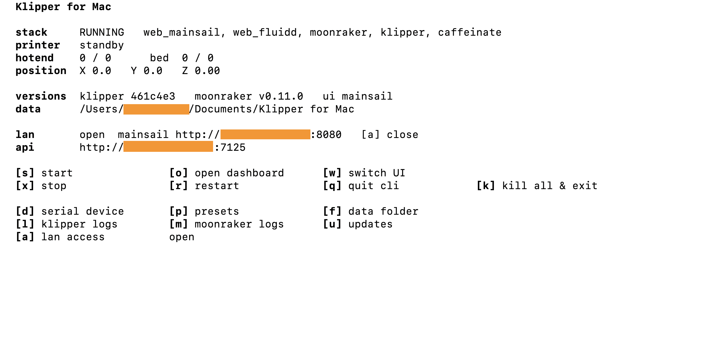
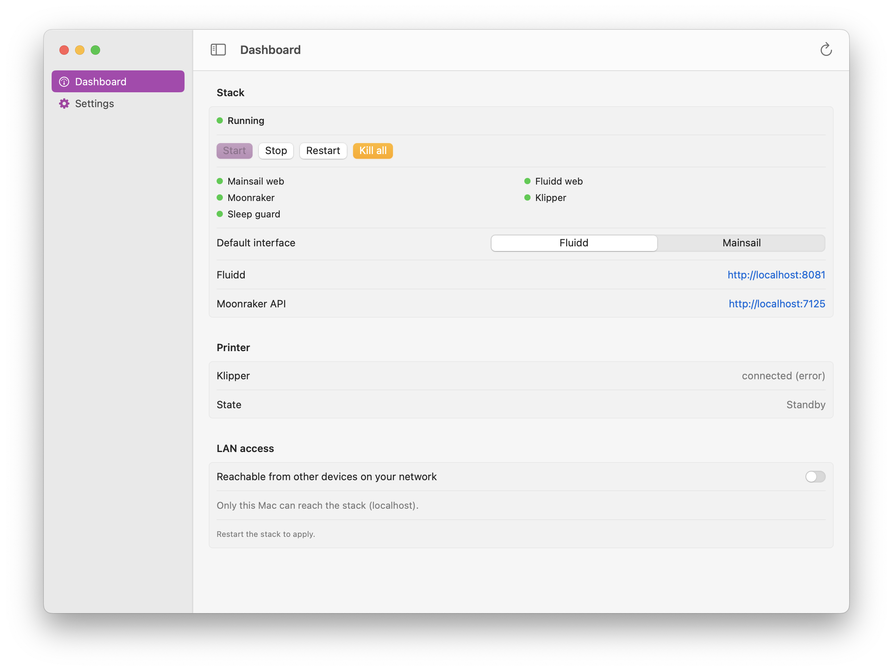

# Klipper for Mac

Run [Klipper](https://www.klipper3d.org) on any Mac — Intel or Apple Silicon —
like it were the Raspberry Pi: plug your printer board into USB and the Mac
becomes the host. No Linux VM, no SD card, no fork — Klipper, Moonraker,
Mainsail and Fluidd are **pristine upstream** at pinned versions. macOS support
lives entirely in small compatibility shims injected at compile time; upstream
files are never edited (`klipperformac doctor` proves it with `git status`).



## Quick start — GUI app

Download `Klipper-for-Mac.zip` from
[Releases](https://github.com/ProtonKicker/Klipper-for-Mac/releases), unzip it,
drag **Klipper for Mac.app** into Applications, and launch it. The ZIP contains
a working `klipperformac` CLI **and its own Python 3.12 runtime** for both
architectures — no separate CLI installer, no separate Python, no Homebrew
Python, and no `scripts/install.sh` are needed. The universal GUI still targets
**macOS 10.15+ (Intel)** and **11+ (Apple Silicon)**; the bundled Intel runtime
targets 10.15 and the Apple Silicon runtime targets 11.0.

In the app choose **Printer → Setup → Install stack**. That first-time step
still requires these *system* prerequisites (the app shows a checklist and
setup performs the authoritative checks; the app does not install them for
you):

- **git + a C compiler** — install Xcode Command Line Tools: `xcode-select --install`
- **libsodium** — required by Moonraker's authentication: `brew install libsodium` (or install it from another source)
- **internet access** — setup fetches the pinned pristine upstream Klipper,
  Moonraker, Mainsail and Fluidd components

After setup, plug in the printer board, pick its serial device in the Printer
pane, and press Start. Fluidd is at **http://localhost:8081** (Mainsail :8080).
`printer.cfg` starts as upstream's `generic-rambo.cfg` example — replace it
with your printer's real config (the Presets picker can import one).

The app is ad-hoc signed (notarization planned), so right-click → **Open**
works around the first-launch warning. It resolves its bundled CLI from inside
its own bundle, so it works from any install location, not just /Applications.

## Terminal CLI (optional)

The command-line/TUI installer is still available for scripting, but is **not**
needed for the GUI:

```sh
curl -fsSL https://raw.githubusercontent.com/ProtonKicker/Klipper-for-Mac/main/scripts/install.sh | sh
export PATH="$HOME/.local/bin:$PATH"   # once, if prompted

klipperformac setup          # fetch upstream components, build, verify
klipperformac serial --auto  # plug in the printer board first
klipperformac up             # start everything, keep the Mac awake
```

That installer needs **macOS 10.15+ (Apple Silicon 11+)**, Xcode Command Line
Tools, a **Python ≥ 3.10 you provide** (python.org works on 10.15), and
libsodium. The GUI does not have these Python/CLI requirements because it ships
its own. Bare `klipperformac` opens the interactive TUI.

## Building the GUI from source

A full clone is needed: `./scripts/fetch-python-runtimes.sh` downloads the two
relocatable CPython runtimes into `.build/pythons` (requires `uv`), then
`KlipperMac/build-app.sh` bundles them with the CLI; `KLIPPERFORMAC_ZIP=1` also
emits the ZIP. Command Line Tools are the only compiler requirement. The build
compiles a universal GUI binary against the macOS 10.15 target — the compiler
rejects any API newer than 10.15 (`-warnings-as-errors`), so the minimum OS is
enforced by construction. `scripts/verify_bundle.py` checks the app and ZIP.



## Orca Slicer

Slice on the Mac and send jobs straight to the printer. In Orca (≥ 2.3),
**Prepare → Add Printer**: type `Moonraker (Klipper)`, host
`http://localhost:7125` — the API port, *not* the dashboard ports
(:8080/:8081). No key needed; `localhost` is already trusted. From another
computer, turn on LAN access below and use `http://<Mac's LAN IP>:7125`.
Uploads, start/pause/cancel and progress work as against a Pi host.

## Access from other devices

```sh
klipperformac lan on && klipperformac restart   # prints the LAN URLs; `lan off` locks back to localhost
```

Dashboards at `http://192.168.x.x:8080/8081`, API at `:7125`; the TUI shows
the same addresses. Tradeoff: Moonraker trusts private network ranges
password-free, so anyone on your LAN can control the printer — fine at home,
off at the café.

## Commands

`klipperformac` with no arguments is the TUI; these are the CLI equivalents.

| command | what it does |
|---|---|
| `setup` | clone pinned Klipper/Moonraker, fetch Fluidd + Mainsail, build venv, verify |
| `up` / `down` / `restart` | start/stop the stack (`caffeinate` keeps Mac awake) |
| `killall` | force-kill the stack plus stray leftovers |
| `status` | service state, pinned versions, available updates |
| `lan [on\|off]` | show/toggle access for other devices |
| `serial` | list USB serials; `--auto`/`--set PATH` writes `[mcu] serial:` into printer.cfg |
| `data` | show data folder; `--set PATH` moves everything there |
| `presets` | config presets (`--save/--use/--import`, auto-backup) |
| `ui [fluidd\|mainsail]` | switch the default dashboard and open it |
| `gcode …` / `--status` | send G-code / query printer state |
| `logs [klipper\|moonraker] [-f]` | tail logs |
| `update [--apply]` | check upstream; re-fetch pinned tags and rebuild (never automatic) |
| `doctor` / `selftest` | environment / end-to-end link checks |
| `uninstall` | remove everything; asks before deleting the data folder (`--data`/`--keep-data`) |

## Where things live

- `~/Documents/Klipper for Mac/` — **your files**: configs, presets, g-codes,
  logs, web UIs (`klipperformac data --set PATH` to move it).
- `~/.klipperformac/` — app internals (checkouts, venv); deleting it
  factory-resets while your data survives. `uninstall` removes both, asking
  first about the data folder.

## How it works

Klipper's host is nearly portable C + Python already; on macOS only two system
headers (`<linux/can.h>`, `<sys/prctl.h>`) are missing — this project ships
~20-line stubs via `CPATH`, plus a tiny `sitecustomize.py` and `ip` shim in the
venv so Moonraker/Mainsail run unmodified. Timing is comfortable: Klipper
tolerates hundreds of ms of host latency; macOS delivers sub-millisecond.
The one rule: **the Mac must stay awake while printing** — `up` runs
`caffeinate` for you; keep it on AC.

## Limitations

- Not supported by the Klipper project ("possible but unsupported"); Klipper
  bugs still go upstream.
- `SHAPER_CALIBRATE` needs Python 3.14: `KLIPPERFORMAC_PYTHON=…3.14 klipperformac setup`.
- No CAN bus, host GPIO, KlipperScreen, or webcam in v1.
- `.app` GUI is ad-hoc signed; right-click → Open on first launch.

## For developers

The same checks CI runs locally:

```sh
make lint       # ruff check + format (klipperformac, bin, scripts, tests)
make test       # pytest — offline CLI unit/integration suite
make build      # universal GUI build, macOS 10.15 floor (swiftc
                #   -warnings-as-errors rejects newer APIs by construction)
make zip        # build + emit dist/Klipper-for-Mac.zip
make verify     # build + verify app, ZIP, both runtimes, CLI --help
make smoke      # import + CLI sanity
```

`pyproject.toml` pins the ruff/pytest behavior; `requirements-dev.txt` pins the
tool versions. The pytest suite is fully offline (no network, no printer
hardware) and fast — everything touches a throwaway `KLIPPERFORMAC_HOME`.

## License

Klipper for Mac: MIT. Upstream components remain unmodified under their own
licenses (Klipper/Moonraker/Mainsail/Fluidd: GPLv3 — see [NOTICE](NOTICE)).
Not affiliated with the Klipper project.
